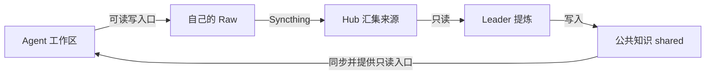

<p align="center">
  
</p>

<h1 align="center">KiokuNet</h1>

<p align="center">
  <strong>让每个 Agent 的思考，成为共同的记忆。</strong><br>
  A local-first memory network for your agents.
</p>

<p align="center">
  <a href="https://github.com/youranreus/KiokuNet/releases/latest"></a>
  <a href="#项目状态"></a>
  <a href="#安装"></a>
  <a href="#项目状态"></a>
</p>

<p align="center">
  <a href="#快速接入">快速接入</a> ·
  <a href="knowledge/usage.md">使用指南</a> ·
  <a href="https://github.com/youranreus/KiokuNet/releases">下载</a> ·
  <a href="knowledge/releasing.md">发布指南</a> ·
  <a href="https://github.com/youranreus/KiokuNet/issues">反馈问题</a>
</p>

---

你在不同机器、不同 Agent 里积累的背景、偏好和项目决策，值得被下一次工作继续使用。

**KiokuNet 把知识保存在本地普通文件中，并把目录接到 Agent 工作区。** 自己的 Raw 可以自由编辑、重命名和删除；公共知识由 Leader 提炼后分发，普通 Agent 只读。文件位置由参数指定，普通读写不需要 Skill 或运行时身份绑定。

## 如何工作



每个来源目录只有一个写入节点，支持离线访问和最终一致同步。多个工作区可以链接同一来源目录。系统只维护当前文件，不提供历史保存、快照或恢复；来源删除不自动撤回已经提炼的公共知识。

## 安装

需要 Node.js ≥ 22.20、npm，macOS 或 Linux（arm64 / amd64）。当前源码安装：

```bash
npm ci
npm run build
npm install -g .
kioku --help
```

[已发布版本](https://github.com/youranreus/KiokuNet/releases) 可能仍是原有 Skill 接入方式；目录接入请使用包含本次改动的版本。CLI 自动寻找或下载并校验 Syncthing。

## 快速接入

同步服务与 Agent 使用不同系统账号。管理员先按 [权限准备](knowledge/usage.md#权限准备) 设置目录与账号，再建立工作区入口：

```bash
kioku workspace attach --home /var/lib/kioku-config \
  --source /srv/kioku/agents/writer/raw \
  --raw-path /work/project/memory \
  --shared-path /work/project/knowledge \
  --user agent-worker

kioku workspace check --home /var/lib/kioku-config
kioku workspace detach --home /var/lib/kioku-config \
  --raw-path /work/project/memory
```

两个目标路径的父目录需已存在；已有不同内容时报错，相同映射重复执行成功。解除接入只移除登记的链接，源文件保留。接入命令由能管理这些目录的管理员或基础设施账号执行，Agent 进程实际使用 `--user` 指定的无特权系统账号。

**符号链接本身没有只读能力。** CLI 验证源目录、父目录、私有配置和系统账号权限，同账号运行、权限可绕过或存在无法验证的 ACL 时拒绝接入。当前提供独立 Unix 账号后端，不按 Agent 品牌设兼容名单；容器中的 UID 映射或额外沙箱需自行保证一致，不能把宿主机一次检查当成任意运行环境认证。

Leader 接入额外指定 `--all-raw-path`，可以写 shared、只读其他 Raw。Leader 保留 `kioku-curate` Skill；运行和定时任务仍由已有运行器管理。普通 Agent 不安装 memory Skill，不自动修改提示词或工作区规则。

## 项目状态

本次改动提供目录接入和权限前置检查，替换原有普通 Agent Skill 接入。原有配对、同步和迁移管理命令保留兼容；其中的 Agent ID 是内部来源标识，日常文件操作无需使用。

原先 Linux Hub ↔ Mac 的实际同步验证见 [历史验收](knowledge/2026-10-15-linux-hub-e2e-acceptance.md)。新的系统账号隔离需要在实际部署环境中验证；本地测试与其限制见 [使用指南](knowledge/usage.md#开发验证)。

## 文档导航

| 内容 | 文档 |
| --- | --- |
| 配对、权限准备、接入和升级 | [使用与运维指南](knowledge/usage.md) |
| 目录归属、权限和取消历史功能的决策 | [ADR 0004](knowledge/adr/0004-workspace-directories-and-current-state.md) |
| Leader 如何提炼当前文件 | [kioku-curate](skills/kioku-curate/SKILL.md) |
| 领域术语 | [术语表](knowledge/GLOSSARY.md) |
| 构建与发布 | [发布指南](knowledge/releasing.md) |

## 参与开发

```bash
npm ci
npm run test:prepare
npm run build
node --test test/*.test.mjs test/integration/*.test.mjs
npm run typecheck
npm run format:check
```

测试使用临时目录，集成测试需要本地端口权限。系统账号实际读写测试需要 root；普通用户执行时会明确跳过。[反馈问题](https://github.com/youranreus/KiokuNet/issues) 时请附系统、版本和去除敏感信息的复现步骤。
