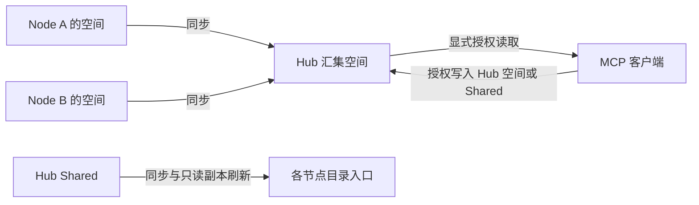

<p align="center"></p>

# KiokuNet

本地优先的知识空间，让你的多台机器共享知识。

KiokuNet 管理机器、知识目录、同步和访问。知识由什么程序使用、如何采集或整理，由你决定。

## 产品概念

- **Node**：接入 Syncthing 网络的机器，例如 VPS、Mac 或 Linux 电脑。一台机器可以拥有多个空间。
- **Knowledge Space**：网络内标识唯一的知识目录，同一时刻只有一个写入节点。一个空间可以映射到多个本地路径。
- **Hub**：中心节点，汇集全部空间的副本。普通节点只保存自己的空间与 Shared。
- **Shared**：暂时独立的网络公共知识区，由 Hub 写入并分发。普通目录入口使用只读副本，Hub 可显式创建可写入口。



产品不管理 Agent 身份、角色、会话或执行调度。默认 `kioku` skill 是操作指南；可选 `kioku-curate` 提供一种整理实践，也可以使用自己的流程。

## 安装

要求 Node.js ≥22.20，支持 macOS / Linux。1.0.0 采用 Node / Knowledge Space 模型，包含破坏性接口及配置更新；从 0.x 升级前请阅读[升级指南](knowledge/upgrading.md)。

```sh
npm install -g @reus-able/kioku-net
kioku skill install --runtime codex
```

从本仓库运行：

```sh
npm ci
npm run build
node dist/cli.js --help
```

## 快速开始

在 Hub 上：

```sh
kioku init --address hub.example:22000
kioku invite --out /absolute/path/invite.json
```

将邀请交给另一台机器，在该机器上：

```sh
kioku join --invite /absolute/path/invite.json --out /absolute/path/receipt.json
```

把回执交回 Hub 执行 `kioku enroll --receipt /absolute/path/receipt.json`。机器配对后，在写入节点创建空间：

```sh
kioku space add --space work
kioku space map --space work --path /absolute/project/knowledge
kioku shared map --path /absolute/project/shared
```

父目录必须已存在，入口路径不能覆盖已有文件。空间本体位于 `<安装根>/data/spaces/work/`；映射只提供入口，不自动触发任何程序读取。

Hub MCP 的授权示例：

```sh
kioku mcp enable --public-url https://knowledge.example/mcp
kioku mcp oauth enable
kioku mcp oauth approve --read-space '*' --shared read-write
```

该凭证用于浏览器授权页面，授予读取所有当前及未来空间、读写 Shared；不授予任何空间写入权限。公网 HTTPS 由反向代理提供。详见 [MCP](knowledge/mcp.md) 与 [OAuth](knowledge/oauth.md)。

## 升级与文档

- [使用指南](knowledge/usage.md)：安装、节点、空间、目录映射及服务。
- [升级指南](knowledge/upgrading.md)：版本 1 目录与配置的预览、迁移、重新授权和中断恢复。
- [术语表](knowledge/GLOSSARY.md) 与 [架构决策](knowledge/adr/README.md)。

默认安装根为 `~/.kiokunet`，可通过 `--home` 或 `KIOKU_HOME` 指定。同步与副本刷新是最终一致，产品不提供知识历史版本恢复；只读副本用于防误写，不隔离主动绕过它的本机所有者。

## 开发验证

```sh
npm run typecheck
npm test
npm run test:prepare
npm run test:integration
npm run format:check
```

集成测试使用临时目录中的独立节点。原生服务安装与真实 skill 分发测试分别由 `KIOKU_TEST_NATIVE=1`、`KIOKU_TEST_SKILLS=1` 显式开启。
