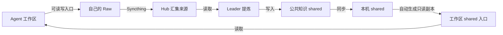

<p align="center">
  
</p>

<h1 align="center">KiokuNet</h1>

<p align="center">
  <strong>让每个 Agent 的思考，成为共同的记忆。</strong><br>
  A local-first memory network for your agents.
</p>

<p align="center">
  <a href="https://github.com/youranreus/KiokuNet/releases/latest"></a>
  <a href="#项目状态"></a>
  <a href="#安装"></a>
  <a href="#项目状态"></a>
</p>

<p align="center">
  <a href="#快速接入">快速接入</a> ·
  <a href="knowledge/usage.md">使用指南</a> ·
  <a href="https://github.com/youranreus/KiokuNet/releases">下载</a> ·
  <a href="knowledge/releasing.md">发布指南</a> ·
  <a href="https://github.com/youranreus/KiokuNet/issues">反馈问题</a>
</p>

---

你在不同机器、不同 Agent 里积累的背景、偏好和项目决策，值得被下一次工作继续使用。

**KiokuNet 把知识保存在本地普通文件中，并把目录接到 Agent 工作区。** 自己的 Raw 可以自由编辑、重命名和删除；公共知识由 Leader 提炼后分发，普通 Agent 只读。文件位置由参数指定，普通读写不需要 Skill 或运行时身份绑定。

## 如何工作



每个来源目录只有一个写入节点，支持离线访问和最终一致同步。多个工作区可以链接同一来源目录。系统只维护当前文件，不提供历史保存、快照或恢复；来源删除不自动撤回已经提炼的公共知识。

Hub 还可显式启用 [MCP 服务](knowledge/mcp.md)，让 Codex、Claude Code 等远程客户端通过 Bearer 密钥列目录、读写文本和批量关键词搜索。普通 Agent 只写自己的 Hub Raw，Leader 可远程维护 shared，远端节点的 Raw 保持只读。公网 HTTPS 由反向代理提供。

## 安装

需要 Node.js ≥ 22.20、npm，macOS 或 Linux（arm64 / amd64）。从 npm 安装：

```bash
npm install -g @reus-able/kioku-net
kioku --help
```

预发布版本使用 `npm install -g @reus-able/kioku-net@next`。也可下载 [GitHub Release](https://github.com/youranreus/KiokuNet/releases) 的 `.tgz`，校验后执行 `npm install -g ./reus-able-kioku-net-<version>.tgz`。发布流程与校验方法见 [发布指南](knowledge/releasing.md)。

当前源码安装：

```bash
npm ci
npm run build
npm install -g .
kioku --help
```

v0.2.0 起支持机器接入与工作区目录接入；v0.1.0 使用原有 Skill 接入方式。CLI 自动寻找或下载并校验 Syncthing。

### 给 Agent 安装使用指南

v0.3.0 起随包提供两个独立 Skill：`kioku` 介绍产品和 CLI 使用，`kioku-curate` 供 Leader 整理公共知识。安装对应版本的 CLI 后，可以在初始化网络前安装通用指南：

```bash
kioku skill install --runtime codex
# 也支持 hermes-agent、pi、universal；--scope project 安装到当前项目
```

默认安装 `kioku`，普通节点和 Hub 均可使用。它按需指导安装、入网、来源与工作区接入、诊断和迁移，不处理知识内容，也不成为文件访问的前置条件。已有 Hub 若需要整理能力，显式执行 `kioku skill install --runtime hermes-agent --skill kioku-curate`；任务仍由原有运行器调度。

## 快速接入

安装根默认是 `~/.kiokunet`，可用 `--home /opt/kiokunet` 整体指定。知识位于 `data/`，配置位于 `config/`，状态、日志与只读副本也集中在安装根内。

```bash
# Hub：先建立网络，不必创建 Agent
kioku init --address <Hub地址>:22000
kioku invite --out ~/.kiokunet/config/mac.invite.json

# Mac：接收邀请，完成机器配对
kioku join --invite /path/to/mac.invite.json --out ~/.kiokunet/config/mac.receipt.json
# 将回执传回 Hub 执行：kioku enroll --receipt /path/to/mac.receipt.json

# Mac：以后创建来源，无需再次配对
kioku source add --agent writer
kioku workspace attach \
  --source ~/.kiokunet/data/agents/writer/raw \
  --raw-path /work/project/memory \
  --shared-path /work/project/knowledge
```

工作区父目录需已存在。普通 Agent 的 shared 入口指向自动更新的只读副本，首次没有可用副本时接入报错。同一来源可接入多个工作区；已有不同内容时拒绝覆盖。`workspace detach --raw-path PATH` 仅移除登记链接，保留知识。

Hub 上通过 `source add --agent leader --role leader` 创建 Leader。Leader 的 shared 入口直接链接可写本体，可额外指定 `--all-raw-path`。运行和提炼任务仍由现有运行器管理。

**只读副本用于防误写。** 不要求独立系统账号，也不阻止同账号进程主动改权限或访问本体。CLI 不修改提示词、不启动 Agent。完整部署、状态诊断和失败恢复见 [使用指南](knowledge/usage.md)。

## 项目状态

机器入网、来源登记与工作区接入已分离；后台负责来源自动登记、同步和 shared 副本刷新。离线创建来源后可先写 Raw，恢复连接后自动登记；同名来源不能接管其他机器的归属。副本刷新失败保留最后成功内容，并在状态中展示错误和更新时间。

当前实现针对新安装，不提供旧版本目录布局迁移。机器与 Agent 的设计边界见 [设计记录](knowledge/2026-10-16-machine-and-agent-access-design.md)；测试结果和平台限制见 [实现记录](knowledge/implementation.md)。

## 文档导航

| 内容 | 文档 |
| --- | --- |
| 机器入网与 Agent 接入方案 | [2026-10-16 设计记录](knowledge/2026-10-16-machine-and-agent-access-design.md) |
| 架构决策及替代关系 | [ADR 索引](knowledge/adr/README.md) |
| 安装、配对、接入与运行状态 | [使用与运维指南](knowledge/usage.md) |
| Hub MCP、密钥、客户端和公网部署 | [MCP 使用指南](knowledge/mcp.md) |
| 目录接入历史决策，账号权限部分已被新方案替代 | [ADR 0004](knowledge/adr/0004-workspace-directories-and-current-state.md) |
| Agent 了解 KiokuNet 和使用 CLI | [kioku](skills/kioku/SKILL.md) |
| Leader 如何提炼当前文件 | [kioku-curate](skills/kioku-curate/SKILL.md) |
| 知识组织默认实践与公共文档模板 | [使用指南](knowledge/usage.md#知识组织的默认实践) · [Shared 输出约定](skills/kioku-curate/references/shared-format.md) |
| 领域术语 | [术语表](knowledge/GLOSSARY.md) |
| 构建与发布 | [发布指南](knowledge/releasing.md) |

## 参与开发

```bash
npm ci
npm run test:prepare
npm run build
node --test test/*.test.mjs test/integration/*.test.mjs
npm run typecheck
npm run format:check
```

测试使用临时目录，集成测试需要本地端口权限。防误写测试使用当前非 root 账号；原生服务和 Skill 分发测试需显式启用。[反馈问题](https://github.com/youranreus/KiokuNet/issues) 时请附系统、版本和去除敏感信息的复现步骤。
