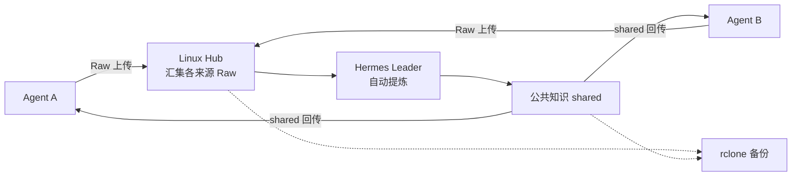

<p align="center">
  
</p>

<h1 align="center">KiokuNet</h1>

<p align="center">
  <strong>让每个 Agent 的思考，成为共同的记忆。</strong><br>
  A local-first memory network for your agents.
</p>

<p align="center">
  <a href="https://github.com/youranreus/KiokuNet/releases/latest"></a>
  <a href="#项目状态"></a>
  <a href="#安装"></a>
  <a href="#项目状态"></a>
</p>

<p align="center">
  <a href="#快速接入">快速接入</a> ·
  <a href="knowledge/usage.md">使用指南</a> ·
  <a href="https://github.com/youranreus/KiokuNet/releases">下载</a> ·
  <a href="knowledge/releasing.md">发布指南</a> ·
  <a href="https://github.com/youranreus/KiokuNet/issues">反馈问题</a>
</p>

---

你在不同机器、不同 Agent 里积累的背景、偏好和项目决策，值得被下一次工作继续使用。

**KiokuNet 把这些知识保存在你自己的文件里。** 每个 Agent 维护独立的原始记录（Raw），通过固定地址的 Hub 汇集；Hermes Leader 自动整理成公共知识，再同步回各节点。用一个 CLI 完成接入，让现有 Agent 通过 Skill 读写记忆。

## 为什么使用 KiokuNet

- **文件就在本地。** Markdown 和原始附件可直接查看、搜索和备份；离线时仍可读取已有副本、记录新知识。
- **身份跟着 Agent。** 一台机器支持多个长期实例，各自拥有 Raw，通过显式身份绑定避免混用。
- **知识保留来源。** Leader 自动提炼、去重并保留冲突依据；更正以新记录补充，原始记录继续保留。
- **接入现有工具。** CLI 配置依赖、文件同步和备份服务；`kioku-memory` / `kioku-curate` 接入现有 Agent，整理任务由 Hermes 调度。

## 如何工作



Raw 通过 **Syncthing** 汇集，公共知识由 Leader 写入并下发。CLI 管理身份、路径和基础设施；Hermes 负责运行与调度整理任务。每个 Raw 只由所属节点写入，公共知识只有 Leader 写入。

## 安装

需要 **Node.js ≥ 22.20** 和 npm。目标平台为 macOS / Linux（arm64、amd64）；Linux 原生后台服务使用 systemd。

安装已发布版本，无需在目标机器编译：

```bash
npm install -g https://github.com/youranreus/KiokuNet/releases/download/v0.1.0/kiokunet-0.1.0.tgz
kioku --help
```

[查看所有版本](https://github.com/youranreus/KiokuNet/releases) · [下载 SHA-256 校验文件](https://github.com/youranreus/KiokuNet/releases/download/v0.1.0/SHA256SUMS) · [校验与安装说明](knowledge/releasing.md#用户安装)

CLI 会寻找或下载 Syncthing / rclone；解包需要 `unzip`，Linux 还需 `tar`。Node.js 需自行安装。目前通过 GitHub Release 分发，尚未发布到 npm registry。

## 快速接入

准备一台有固定可达地址的 Linux Hub。下面的 `192.0.2.10` 为示例，请替换为实际地址，并允许节点访问 Hub 的 **TCP 22000**。

**1. 在 Hub 创建网络和邀请**

```bash
kioku init --agent hermes-main --root "$HOME/kiokunet" --address 192.0.2.10:22000
kioku invite --agent codex-mac --out /tmp/codex-mac.invite.json
```

**2. 将邀请传到本机，再执行接入**

```bash
kioku join --invite /tmp/codex-mac.invite.json \
  --root "$HOME/kiokunet" --out /tmp/codex-mac.receipt.json
kioku skill install --runtime codex
```

**3. 将回执传回 Hub，完成登记并安装 Leader Skill**

```bash
kioku enroll --receipt /tmp/codex-mac.receipt.json
kioku skill install --runtime hermes-agent
kioku status --json
```

两个文件通过可信渠道传递。`join` 成功后仍需 Hub 执行 `enroll`；文件是否同步完成以实际连接和文件夹状态为准。Linux 若提示 linger 权限不足，按 [完整接入指南](knowledge/usage.md#首次接入) 完成服务常驻配置。

**4. 在 Hermes 配置整理任务**

将下面的任务说明交给 Hub 上能加载 `kioku-curate` 的 Hermes profile，先手动验证，再配置定时执行：

> 使用 kioku-curate，身份为 hermes-main。先执行 `kioku context --agent hermes-main --json`，按返回路径增量整理 Raw，保留来源和不确定性，自动更新公共知识并保存进度，无需人工确认。

多个本地 Agent 共用一套配置时，为各自执行环境绑定 `KIOKU_AGENT_ID`，或在查询时传 `--agent`。身份和机器路径独立保存在本机配置中，不写入 Skill。详见 [Agent 与 Skill](knowledge/usage.md#agent-与-skill)。

## 项目状态

**首版已发布，正在验证真实部署。** 当前验证集中在 macOS 本机环境；Linux Hub、真实云备份和 Hermes 定时整理闭环仍待实机验收。

| 已验证 | 待完成 |
| --- | --- |
| 邀请与回执登记、同机多身份、迁移与撤销 | Linux 服务重启与退出登录后的持续运行 |
| 真实 Syncthing 双端 Raw / shared 同步 | 实际 Hermes profile 的增量提炼与定时执行 |
| rclone 本地后端快照、损坏检测与跨网络恢复 | 真实云存储备份与恢复演练 |
| macOS 后台服务、Codex / Hermes Skill 分发 | 多机器端到端时效验证 |

查看 [详细验收记录](knowledge/implementation.md)。当前按个人可信协作场景设计；身份与同步方向约定不构成同一系统用户下的强权限隔离。备份需要单独配置后才生效。

## 文档导航

| 我想了解 | 从这里开始 |
| --- | --- |
| 完整安装、首次接入与身份绑定 | [使用与运维指南](knowledge/usage.md) |
| 备份、灾难恢复与换机迁移 | [备份与恢复](knowledge/usage.md#备份与灾难恢复) · [迁移与撤销](knowledge/usage.md#身份迁移与撤销) |
| Agent 如何读取和记录知识 | [kioku-memory](skills/kioku-memory/SKILL.md) |
| Leader 如何提炼公共知识 | [kioku-curate](skills/kioku-curate/SKILL.md) |
| 架构取舍和名词含义 | [架构决策](knowledge/adr/README.md) · [术语表](knowledge/GLOSSARY.md) |
| 如何构建、测试与发布 | [开发说明](knowledge/usage.md#运维与开发) · [发布指南](knowledge/releasing.md) |

## 参与开发

欢迎通过 [Issues](https://github.com/youranreus/KiokuNet/issues) 提交问题和建议。报告问题时附上系统、Node.js 版本、复现步骤和去除敏感信息的错误输出。

```bash
git clone https://github.com/youranreus/KiokuNet.git
cd KiokuNet
npm ci
npm test
```

涉及同步或备份的改动，再执行 `npm run test:prepare` 和 `npm run test:integration`。集成测试需要本地端口权限；完整命令和可选测试见 [开发说明](knowledge/usage.md#运维与开发)。
