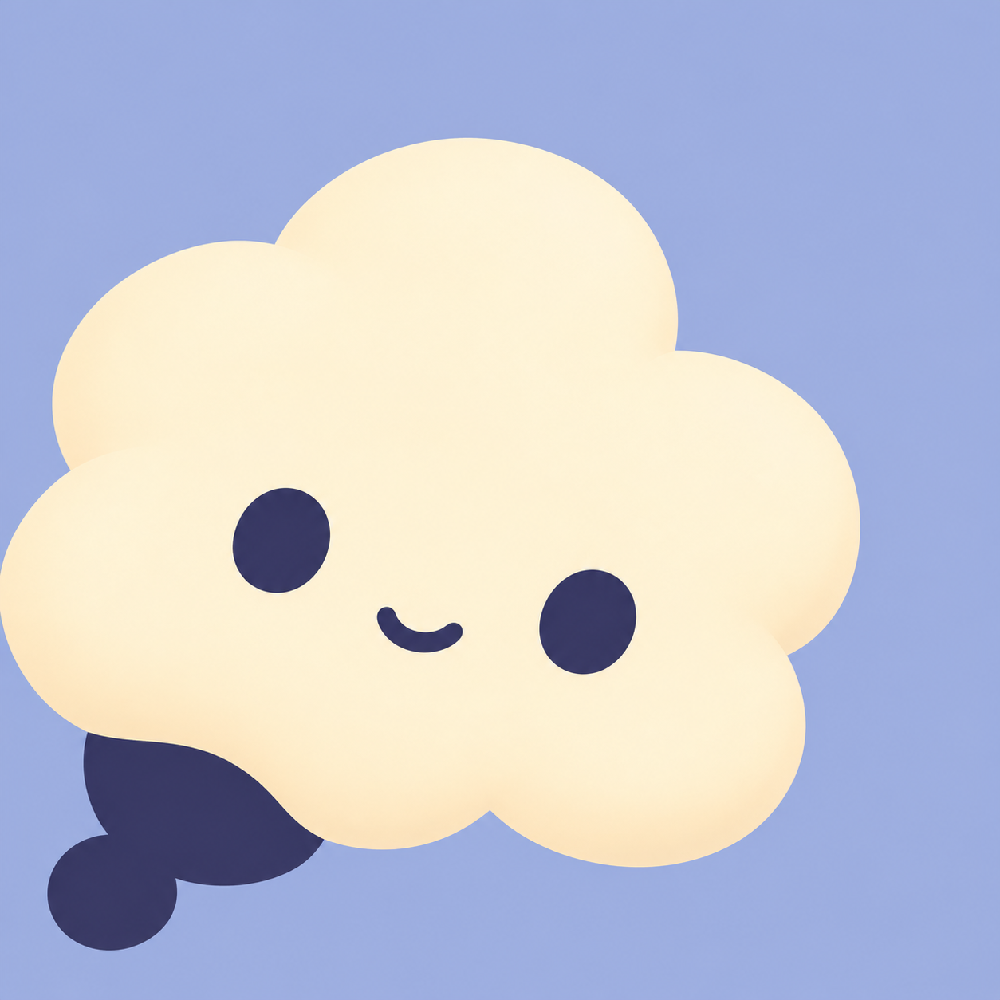

# KiokuNet 思考气泡

六张候选对应三个方向，每个方向分别从左下角、右下角浮现。候选全部保留首次生成的原图，没有重绘或后处理。已选定 **A2 · 云朵思考泡（右下角）** 作为项目形象；README 使用的 `kiokunet-rounded.png` 为按用户要求通过内置 image_gen 编辑的圆角版本，四角外侧透明，A2 原图仍保存在候选目录中。编辑提示词见 [rounded-edit.json](rounded-edit.json)。

| 方向与产品联系 | 左下角 | 右下角 |
| --- | --- | --- |
| **A · 云朵思考泡**：蓬松云瓣承载个人记忆 |  |  |
| **B · 连结思考泡**：宽圆轮廓与相连泡尾表达知识流转 |  |  |
| **C · 沉思小气泡**：矮胖轮廓与双叶泡尾呈现安静可靠的记忆伙伴 |  |  |

| 方向 | 主体两色 | 背景 |
| --- | --- | --- |
| A | 奶油白 `#FFF0CC`、深靛 `#34365E` | 柔和长春花蓝 `#A9B7DF` |
| B | 湖蓝 `#58C8C7`、深青 `#154A57` | 奶杏 `#F1D7B4` |
| C | 淡紫 `#BCABF2`、深紫 `#49356F` | 薄荷 `#C4DED0` |

全部为原生 **1254 × 1254 PNG**。Provider 为 OpenAI 内置 `image_gen`；运行时未公开具体模型名称。约束使用 `main-prompt constraints`，没有独立 negative prompt 参数。

完整提示词、配色和生成记录：[A1](candidates/a1.json) · [A2](candidates/a2.json) · [B1](candidates/b1.json) · [B2](candidates/b2.json) · [C1](candidates/c1.json) · [C2](candidates/c2.json)。

候选与记录仅保存在仓库中；npm 分发包只包含 README 使用的 `kiokunet-rounded.png`。
