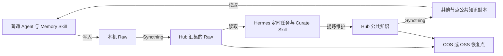

> 历史记录：当前产品概念与接口以 [ADR 0009](adr/0009-nodes-spaces-and-explicit-access.md) 和[使用指南](usage.md)为准；本文保留当时的设计与验证事实。

# KiokuNet 首版设计讨论记录

> 本文保留首版历史背景；最新已实现的接入设计见 [2026-10-16 接入设计](2026-10-16-machine-and-agent-access-design.md)，完整决策替代关系见 [ADR 索引](adr/README.md)。当前可执行流程见 [使用指南](usage.md)。

> 本文保留设计确认记录。首版实现及验证进展见 [实现记录](implementation.md)，实际操作见 [README](../README.md)。

- 日期：2026-10-15，Asia/Shanghai。
- 参与人：reuszeng、Codex。
- 状态：本记录中的“已确认”方案已经逐项获得用户认可；CLI、Skill 和部署尚未实现。
- 前置讨论：[ChatGPT 对话《知识库架构选型》](https://chatgpt.com/g/g-p-69d676210f708191a667707c13a47156-aixue-xi/c/6acd8a44-1614-83ea-b608-df0744df4c19)。本次工作目录中的后续访谈是最终决策来源。
- 记录性质：按主题整理的讨论结论，不是逐字聊天导出，也不是已经完成的实现规格。

## 背景与目标

用户的 Agent 分布在不同机器。每个 Agent 需要维护自己的原始知识，同时共享个人信息、偏好、项目决策等长期知识。用户希望通过命令确认身份、角色和本地目录，由脚本完成接入及基础设施配置。

项目名称确定为 **KiokuNet**。首版服务用户自己控制的 Agent，采用本地文件工作副本、中心知识节点和云备份；保留原始资料，不绑定某个模型或 Agent 的内置 Memory 格式。

首版成功链路：一个 Agent 写 Raw，文件汇集到 Hub，Hermes Leader 提炼并保留来源，公共知识分发到另一台机器并被其 Agent 使用；重启后知识仍然可用，云备份能够恢复。

## 已确认的产品边界

| 方面 | 决策 |
| --- | --- |
| 用户范围 | 个人自托管；首版不做多租户平台和 Web 管理界面。 |
| 交付形态 | Node.js + TypeScript CLI；支持 macOS 和 Linux，各机器本地执行接入命令。 |
| 首批拓扑 | 当前 Mac + 一台常在线 Linux；Linux 同时运行 Hub、远端 Hermes Leader 和云备份。 |
| 知识产生 | Agent 根据 Skill 主动落盘；首版不自动采集全部历史对话或内部 Memory。 |
| 内容范围 | 自动提炼 Markdown；附件原样保存并保留引用，暂不自动解析 PDF、图片、音视频。 |
| 整理权限 | Leader 自动提炼、处理冲突和发布，不等待人工审批；保留来源、依据、版本和不确定性。 |
| Agent 调度 | 用户在 Hermes 中自行配置定时任务。KiokuNet 不调用模型，不启动 Agent 工作任务，不管理其执行、重试或跨 Agent 任务派发。 |
| 基础设施 | CLI 配置依赖、目录和同步/备份后台服务，重复执行应保留已有配置与数据。 |
| 知识访问 | 使用普通文件、索引和文本搜索；首版不引入向量数据库。 |

## 组件职责与数据流

| 组件 | 职责 |
| --- | --- |
| KiokuNet CLI | 网络及 Agent 登记、本地路径、设备配对、同步和备份基础设施、上下文查询、状态与诊断。 |
| Syncthing | Agent Raw 到 Hub 的工作同步，以及 Hub 公共知识向节点分发。 |
| rclone | Hub 向 COS/OSS 传输备份数据；恢复点、保留策略和校验由 KiokuNet 备份流程落实。 |
| `skills` CLI | 通用 Skill 安装、更新与移除；KiokuNet 可提供薄安装封装。 |
| Memory Skill | 指导普通 Agent 查阅公共知识并记录自己的 Raw。 |
| Curate Skill | 指导 Leader 提炼、纠错、更新索引和保存处理进度。 |
| Hermes | 按用户配置的定时任务执行 Curate Skill，负责 Agent 执行及失败处理。 |



Hub 暂时不可用时，普通节点继续写本地 Raw，并读取已有公共副本；连接恢复后再同步。工作同步是最终一致的，不保证刚写入就能在另一台机器读取。

正常联网且 Hermes 可运行时，以 **5 分钟内完成知识流转**为验收目标，包含同步与实际整理耗时。该目标需实测，不是 CLI 单独承诺的时效；手动提前整理也由 Hermes 侧触发。

## 身份与权限

区分节点、运行器、长期 Agent 实例和会话，定义见 [领域术语](GLOSSARY.md)。一台机器支持多个 Agent，同一运行器也可能承载不同长期实例；不会因新建会话而自动新建 Agent。

- 每个长期实例具有稳定 `agent_id`，Raw 同时只有一个写入节点。
- 接入的 Raw 对 Leader 可读；普通 Agent 按约定读写自己的 Raw、读取公共知识。
- Hub 的初始化及登记流程建立角色和设备共享关系，本地填写角色名称不构成提权。
- 首版采用用户控制下的可信 Agent 协作模式。同一系统用户下的目录划分、Skill 和环境变量不是强安全隔离；跨机器共享范围由实际设备和目录配置约束。
- 若未来要求本机 Agent 相互强隔离，需要另行引入系统用户或容器边界。

### 最终身份解析规则

1. 显式 `--agent` 与 `KIOKU_AGENT_ID` 同时存在且不同：报告冲突。
2. 有显式 `--agent`：使用指定身份。
3. 否则有 `KIOKU_AGENT_ID`：使用环境绑定。
4. 二者都没有且本机只有一个可用 Agent：自动选用。
5. 本机存在多个可用 Agent 而没有明确绑定：报错并列出可选项；零个可用身份时提示先登记。

不根据运行器名称或工作目录猜身份，不提供全机可变的“当前 Agent”。这些规则适用于当前身份解析；邀请或管理命令中的“目标 Agent”参数需与当前身份概念区分。

Hermes 定时任务可在任务说明中明确指定 `hermes-main`，由 Skill 调用 `kioku context --agent hermes-main --json`。如果使用环境变量，需要在真正执行 CLI 的环境中绑定；宿主机变量不保证自动传入其他执行后端。

## 网络与首次配对

用户确认 Linux Hub 有固定可达地址。首版通过该地址直连，默认关闭公网发现和公共中继；Hub 配置同步入站端口，普通节点主动连接。具体 IP、端口尚未写入本项目，固定 IP 本身不代表同步端口已放通。

配对流程固定为：

1. Hub 为指定 Agent 生成邀请文件。
2. 新节点导入邀请、配置本地根目录，生成设备接入回执。
3. Hub 导入回执，完成设备登记及目录共享。
4. 后续自动同步。

首版不建设在线注册服务。邀请和回执由用户通过可信渠道传递，可让两端 Agent 协助执行；其协议、绑定验证和重复导入行为仍需在实现规格中定义。凭据不应通过普通知识同步或接入文件传播。

## 知识组织与生命周期

公共知识采用以下初始逻辑结构，Leader 可以按实际内容扩展分类：

```text
shared/
├── INDEX.md
├── profile/
├── projects/
└── topics/
```

Raw 至少记录记录 ID、来源 Agent、时间和类型。已落盘记录原则上保留原文，纠正和补充通过新增记录引用旧记录完成。公共知识保留来源引用、更新时间，区分事实、建议和不确定信息。

Leader 不改写其他 Agent 的 Raw，不因提炼而自动删除原文。无法消除的冲突允许保留双方证据与不确定性，不伪造确定结论，也不等待人工审批。

整理进度保存在文件中，重复执行应避免反复生成同一条公共知识。实际状态字段、如何识别半同步记录、共享多文件更新的完整性及失败恢复协议仍需实现设计。

Agent 退出时停用接入并保留历史知识；设备撤销不等于删除它已持有的副本。迁移沿用 `agent_id`、更换设备身份，先停用旧写入节点再启用新节点。知识删除必须显式操作并二次确认。

## Skill 分发与本地配置

采用静态通用 Skill，由 `skills` CLI 分发。拟提供 `kioku-memory` 与 `kioku-curate`；具体名字仍属于接口草案。Skill 不硬编码本机身份、角色和知识目录，执行时通过 `kioku context` 获取绝对路径和必要上下文，输出不得包含凭据。

KiokuNet 保管本地配置，可以提供薄的 `kioku skill install` 封装；不自行建立 Skill 市场或第二套更新协议。保留现有 Agent 内置 Memory，不自动搬迁；可为其他运行器导出通用 Skill。

截至本次讨论的官方资料核查：`skills@1.7.2` 已发布并支持 `codex` 和 `hermes-agent`，要求 Node.js ≥ 22.20.0。安装支持 Git 来源、本地目录、目标运行器、全局/项目范围及非交互选项。未来实施时应重新验证版本兼容性，不能将当日版本视为永久默认。

更新会重装 Skill，因此本地配置必须独立保存。本地目录来源适合开发，不能假定可自动追踪仓库更新；正式分发选择 Git 来源。该版本的 `skills check` 实际进入更新流程，不能用作只读诊断。

这些是资料核查结论；本轮未执行 Skill 安装，也未验证远端 Hermes 的版本、profile 或实际目录可见性。

## 备份与恢复

Hub 集中配置 COS/OSS，普通节点不持有云凭据。允许先接通工作同步，随后配置云备份；在备份和恢复演练完成前，状态仍显示备份未就绪，首版整体验收未完成。

- 每日备份，保留最近 30 天恢复点。
- 故障恢复目标：最多损失最近 24 小时尚未备份的内容；需要持续成功备份才能满足。
- 默认恢复到新目录，校验后由人工切换，避免把旧快照立即传播到在线网络。
- 进行真实恢复演练；具体恢复点格式、保留清理方式、配置与数据的备份边界仍需细化。

同步副本不是历史备份；持续对同一云目录执行 `rclone copy` 也不会自动产生每日恢复点。

## 访谈决策索引

以下索引保留确认过程，后续以本记录上方的最终状态为准。

| 轮次 | 结论与修正 |
| --- | --- |
| Q1–Q4 | 个人自托管；首版知识流转；Leader 可读接入 Raw；Agent 主动落盘；暂不做任务调度。 |
| Q5–Q10 | 单 Hub、单 Leader；长期实例身份；分钟级目标；Markdown 与附件边界；每日备份和 30 天恢复点。Q7 被用户修正为全部自动提炼和冲突处理，无人工审批。 |
| Q11–Q14 | Mac + Linux；Node.js/TypeScript CLI；Leader 指定为远端 Hermes；Raw 新增记录为主。 |
| Q15–Q18 | 每机本地接入；网络登记角色；真实本地目录；CLI 配置 Syncthing/rclone 及后台服务。 |
| Q19–Q22 | 一机多实例；Hub 集中配置备份。Q20 后续收敛为固定地址直连。Q22 被用户修正为只提供 Skill，Hermes 自己配置定时任务，KiokuNet 不介入 Agent 调度和重试。 |
| Q23 | 邀请文件 + 接入回执，首版不做在线注册服务。 |
| Q24–Q27 | 最小公共知识分类；按角色提供 Skill；退出保留、迁移单写；交互与脚本两种 CLI 使用方式。 |
| Q28、Q30、Q31 | 复用 `skills` 分发并外置本地配置；本机可信协作；恢复到新目录再切换。 |
| Q29 | 详细讨论后确认：单实例自动识别，多实例显式绑定，冲突报错；不按工作目录猜测，不设置全机可变身份。 |

### 已被后续决策替代的提议

- 公共知识冲突等待用户审批：被自动处理、保留证据和不确定性替代。
- KiokuNet 定时调用 Hermes、自动重试 3 次：被 Hermes 自行配置任务替代，不能重新写入 CLI 的职责。
- 默认公网发现和中继：在确认固定可达 Hub 后，替换为固定地址直连。
- 为每个 Agent 改写已安装 Skill 中的本地路径：被通用 Skill + 独立配置 + `context` 查询替代。
- 直接把云存储挂载为工作文件系统或使用 Basic Memory 为核心：属于此前候选，最终首版采用本地文件、Syncthing 和独立云备份。

## 待落实事项

关键产品边界已经确认；以下是实施规格与部署工作，不表示已有实现或验收通过。

### 实施规格

- [ ] 固化 CLI 参数、交互步骤、JSON 结果及退出码；暂定命令见 [CLI 草案](cli-draft.md)。
- [ ] 定义邀请/回执协议、设备与 Agent 绑定、重复导入及撤销/迁移状态。
- [ ] 定义配置、Raw、共享目录和本机状态的物理布局；避免多个同步文件夹互相嵌套。
- [ ] 定义记录完整性、附件到齐判定、共享知识发布和整理进度格式。
- [ ] 明确支持的 Linux 发行版、依赖安装方式、后台服务权限及版本兼容策略。
- [ ] 定义每日恢复点、校验、保留清理及恢复切换步骤。
- [ ] 编写通用 Skill，并验证 Hermes 和 Codex 的实际加载与上下文解析。

### 部署参数

- [ ] Hub 实际地址、同步端口和防火墙放通情况。
- [ ] 各节点根目录、运行账户和首批 `agent_id`。
- [ ] 远端 Hermes 的 profile、Skill 安装范围及执行环境可见路径。
- [ ] COS 或 OSS、Bucket、地域、备份前缀和本机凭据配置方式。
- [ ] CLI 包名/安装来源与 Skill Git 仓库地址；`kioku` 目前仅是拟议命令名。

### 验收

- [ ] 两机完成邀请、回执、登记和自动同步。
- [ ] 普通 Agent 通过 Skill 写 Raw，Hermes 按其定时任务提炼并分发。
- [ ] 第二个节点按 Skill 查阅公共知识，保留来源关系。
- [ ] 验证重复执行、离线后重连和节点重启。
- [ ] 验证身份歧义及冲突报错，避免写错 Raw。
- [ ] 测量正常条件下的端到端流转耗时。
- [ ] 产生云端恢复点，并恢复到新目录验证。

## 官方资料索引

以下资料用于支持技术可行性和限制；用户决策仍以本次访谈为准。

- [Syncthing 文件夹类型](https://docs.syncthing.net/users/foldertypes.html)：Send Only / Receive Only 是同步行为，不等于操作系统权限。
- [Syncthing 防火墙与固定地址](https://docs.syncthing.net/users/firewall.html)：固定 Hub 入站与客户端主动连接。
- [Syncthing 同步机制](https://docs.syncthing.net/users/syncing.html)：需在实现时处理多文件完整性。
- [rclone copy](https://rclone.org/commands/rclone_copy/)：传输行为与历史恢复点的区别。
- [Hermes Skills](https://hermes-agent.nousresearch.com/docs/user-guide/features/skills)、[Hermes Cron](https://hermes-agent.nousresearch.com/docs/user-guide/features/cron)：由 Hermes 自己接入 Skill 和安排任务。
- [skills 官方仓库](https://github.com/vercel-labs/skills)、[当日查询的 npm 元数据](https://registry.npmjs.org/skills/latest)。
- [skills 发布提交的运行器配置](https://github.com/vercel-labs/skills/blob/671e8c320810d36fed80fac5f1a2c1bf7e82d812/src/agents.ts)、[命令分派](https://github.com/vercel-labs/skills/blob/671e8c320810d36fed80fac5f1a2c1bf7e82d812/src/cli.ts)、[更新实现](https://github.com/vercel-labs/skills/blob/671e8c320810d36fed80fac5f1a2c1bf7e82d812/src/update.ts)。
